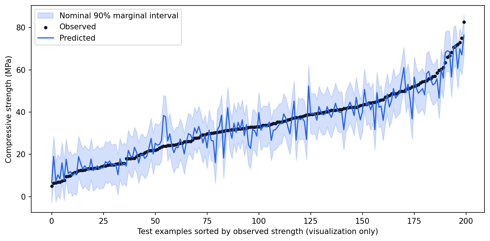
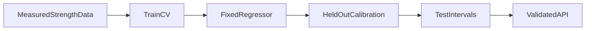

<p align="center"></p>

# Concrete Strength MLOps

**From laboratory data to a validated prediction service.**

[](https://github.com/Djordje3002/concrete-strength-mlops/actions/workflows/ci.yml)


Estimate concrete compressive strength from mixture ingredients and age, then expose the trained model through a documented batch API. The project adds split-conformal intervals, artifact identity, readiness, request validation and descriptive input monitoring to a reproducible regression experiment.

**Project 6/6 · Advanced systems** in the [Machine Learning Portfolio](https://github.com/Djordje3002/ml-portfolio).

## What this project demonstrates

FastAPI · conformal prediction · model artifacts · input validation · service tests · Docker.

Working training and prediction commands, real benchmark data, baseline comparisons, committed measured reports, an experiment-review notebook, regression tests and CI. This is a reproducible portfolio experiment; results describe the stated benchmark protocol.

## Measured results

| Model | mae | rmse | r2 |
| --- | ---: | ---: | ---: |
| `mean_baseline` | 12.7055 | 15.8658 | -0.0076 |
| `scaled_ridge` | 7.9833 | 9.8284 | 0.6133 |
| `hist_gradient_boosting` | 3.3790 | 4.8306 | 0.9066 |


**Selected using training CV or validation:** `hist_gradient_boosting`. The tables report test results; selection is never changed to favor the test winner.

The boosted regressor reaches 3.379 MPa test MAE and R² 0.907 on 200 held-out feature rows. The nominal 90% interval covers 91% of the test targets and is 19.203 MPa wide. Width matters alongside coverage: a high-coverage interval can still be too broad for a decision. Similar mixture families can remain across partitions, so this is not proof of generalization to entirely new recipes or laboratories.



Full precision, split counts, package versions and source provenance are in [metrics.json](reports/metrics.json). The committed run used Python 3.11 on macOS with seed 42. Results can vary slightly across platforms and dependency versions. These numbers are benchmark measurements, not production performance promises.

## Run locally

Use Python 3.11 or 3.12 and run commands from the repository root. No API key, paid service or GPU is required. The first training run downloads the small source archive; subsequent runs verify and reuse the local cache. The digits project uses scikit-learn's bundled dataset instead.

```bash
git clone https://github.com/Djordje3002/concrete-strength-mlops.git
cd concrete-strength-mlops
python3.11 -m venv .venv
source .venv/bin/activate
python -m pip install -e ".[dev]"
python -m concrete_ml train
python -m concrete_ml predict --input examples/sample.json
python -m pytest -q
```

On Windows, activate with `.venv\Scripts\activate`. A Python 3.12 installation can replace `python3.11` in the setup command. Start with a few minutes of CPU time; training time depends on your machine, with the CNN and factorization requiring more work than the small tabular examples.

Training writes local models to `artifacts/` and refreshes `reports/`. Datasets and trained binaries are excluded from Git. The example JSON is an input contract, and predictions are calculated from the locally trained model.

## Experiment design



Rows with identical eight-feature vectors are collapsed to one mean target, preventing exact feature duplicates across splits. The 996 resulting feature rows are split 60%/20%/20% into training/calibration/test. Five-fold training-only CV selects the lowest-MAE model among mean, scaled ridge and histogram boosting. Calibration examples are never fitted. Their absolute residuals define the finite-sample order statistic at rank ceil((n+1)×0.90). Test intervals are evaluated once with that fixed radius. The interval is marginal under exchangeability assumptions, not a per-mixture guarantee.

### Data provenance

UCI Concrete Compressive Strength: 1,030 historical measured examples, eight input features and compressive strength in MPa. Ingredients are measured in kg/m³; age is measured in days. Collapsing identical feature vectors yields 996 unique feature rows; reported targets for those rows are averages when repeats exist.

Source: [Concrete Strength MLOps dataset](https://archive.ics.uci.edu/dataset/165/concrete+compressive+strength). See [Data card](docs/DATA_CARD.md) for attribution, integrity and usage terms.

## Explore the evidence

- [Experiment review notebook](notebooks/01_review_results.ipynb): inspect the committed metrics, compare models and view the actual evaluation chart.
- [Model card](docs/MODEL_CARD.md): intended use, evaluation boundary and failure modes.
- [Experiment protocol](docs/EXPERIMENTS.md): reproduction steps and selection rules.
- [Prediction input](examples/sample.json): a complete example for the command-line interface.

See [API and deployment](docs/API.md) for request/response examples, routes, container commands and operating boundaries.

## Repository structure

```text
src/concrete_ml/       Training, prediction and integrity helpers
tests/                   Offline regression and contract tests
data/source.json         Source URL and expected SHA-256 (downloaded datasets)
data/raw/                Local verified dataset cache; ignored by Git
examples/                Ready-to-run prediction inputs
notebooks/               Executed experiment review
reports/                 Measured metrics and evaluation plots
docs/                    Data card, model card and experiment protocol
artifacts/               Locally trained models; ignored by Git
.github/workflows/       Lint, tests and full benchmark training
```

## Quality checks

```bash
make check test
make train
```

Finite-sample interval ranks and insufficient calibration are checked; missing artifacts return liveness with failed readiness; the API rejects extra fields, numeric strings, invalid ranges and oversized batches; batch intervals, artifact IDs, counters and range monitoring are exercised through HTTP TestClient.

CI repeats lint, formatting, tests and the complete training/evaluation command on Linux, then uploads reports for inspection. Training requires network access only on a cache miss. Offline tests use small constructed fixtures rather than substitute benchmark data.

## Limits and responsible interpretation

This is a portfolio service on historical lab data and cannot approve structural designs, material specifications or safety decisions. Conformal coverage assumes exchangeability and does not survive arbitrary shift. Related recipes may cross splits. Monitoring reports training-range violations and standardized mean shifts; it does not detect accuracy degradation or establish a statistically significant distribution change. Authentication, rate limits, TLS, durable telemetry and a model registry are deployment responsibilities. The included container definition is provided; Docker was unavailable for local execution.

## License and attribution

Code is [MIT licensed](LICENSE). Dataset rights are separate; see [Data card](docs/DATA_CARD.md). Built with Python and the libraries listed in [pyproject.toml](pyproject.toml).

**Dataset citation:** Yeh, I. (1998). Concrete Compressive Strength. UCI Machine Learning Repository. https://doi.org/10.24432/C5PK67

Created by [Djordje Kartaljevic](https://github.com/Djordje3002). [Explore the full progression →](https://github.com/Djordje3002/ml-portfolio)
